# 🚌 SATAS Bus — Moroccan Intercity Coach Booking & Fleet Management Platform

[](https://www.php.net/)
[](https://laravel.com/)
[](https://mariadb.org/)
[](https://tailwindcss.com/)
[](https://alpinejs.dev/)
[](https://www.docker.com/)
[](https://opensource.org/licenses/MIT)

> **SATAS Bus** is a full-stack Moroccan intercity bus booking and fleet management system inspired by platforms like *marKoub.ma*. It digitizes the traveler journey across Morocco with dynamic schedule queries, multi-hop routes, real-time seat inventory checks, simulated credit card checkouts, automated PDF e-ticket generation, and an administrative control center for buses, routes, and revenue metrics.

---

## 📸 Demo & Application Previews

All screenshots are live captures from the containerized application.

### Passenger Flow (Search, Booking & PDF Ticket)

| 01. Landing Page & Route Search | 02. Real-Time Search Results |
|:---:|:---:|
| 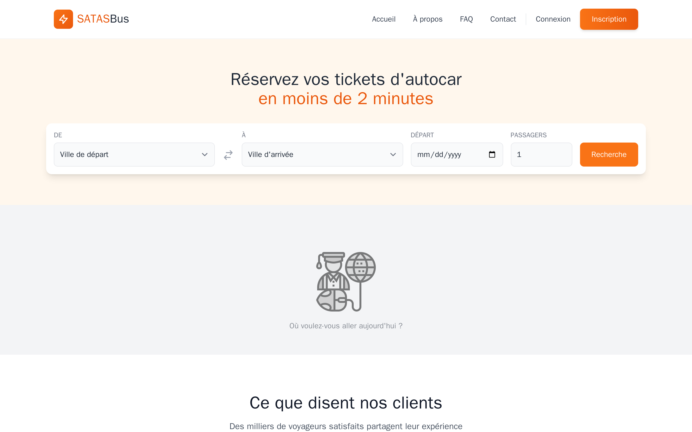 | 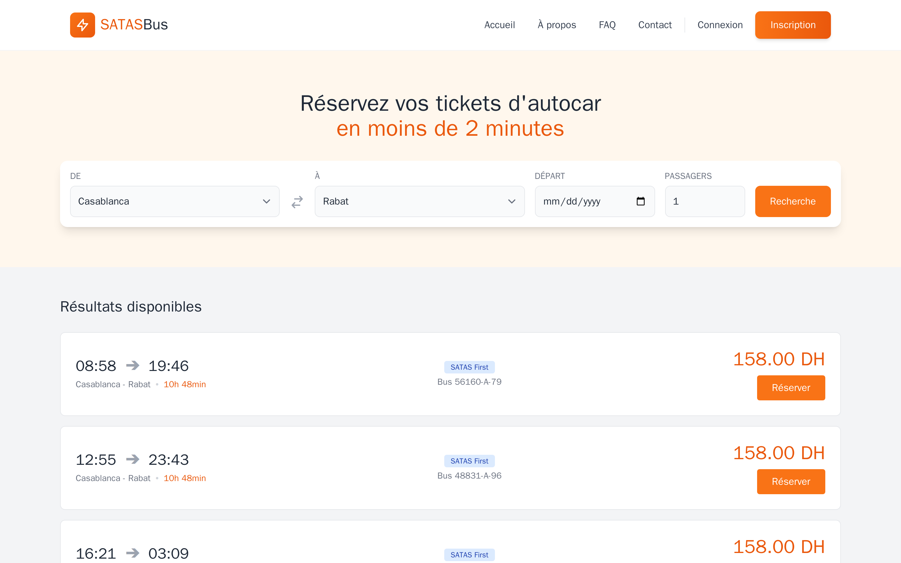 |
| *Hero banner with departure/destination search across 20 Moroccan cities.* | *Filter trips with departure times, operator badges, duration, and MAD pricing.* |

| 05. Secure Checkout (Simulated) | 06. Instant Booking Confirmation |
|:---:|:---:|
| 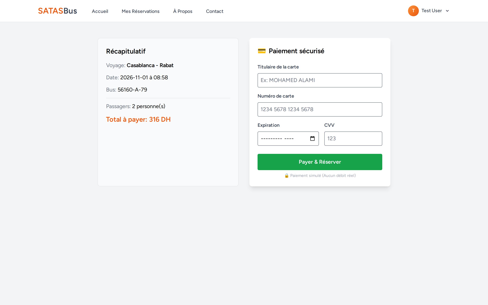 | 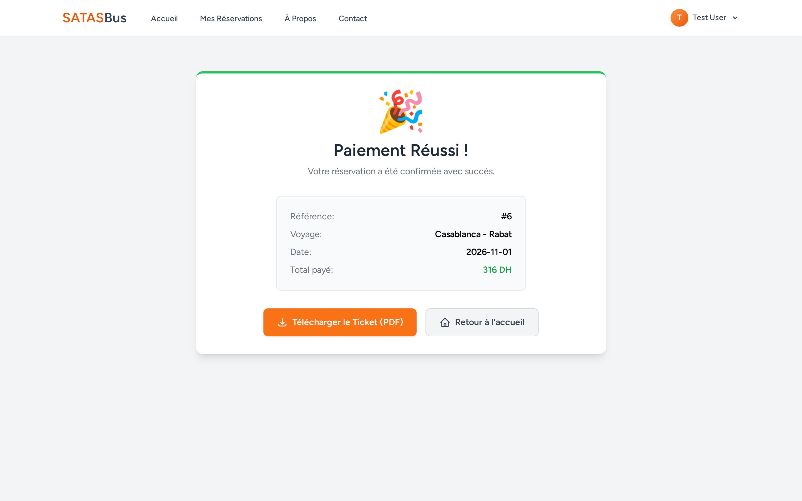 |
| *Passenger summary, seat count, and credit card validation.* | *Instant booking reference with one-click PDF e-ticket download.* |

### User Account & Self-Service Portal

| 07. Passenger Dashboard | 08. User Profile Management |
|:---:|:---:|
| 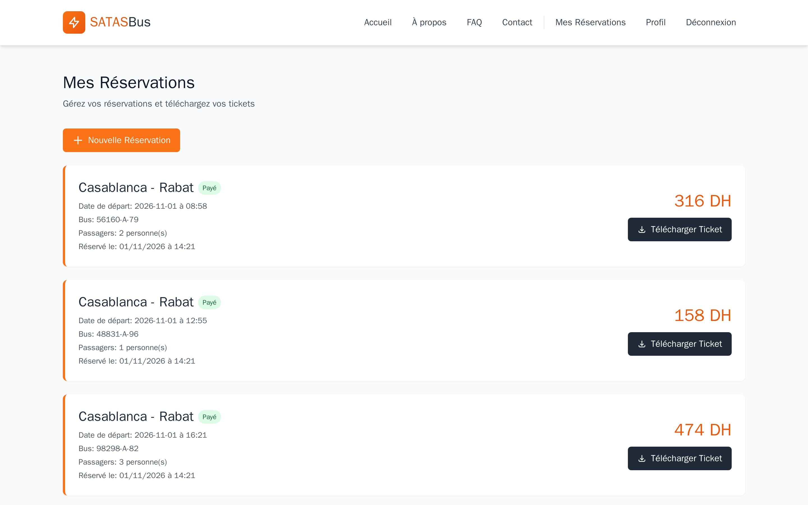 | 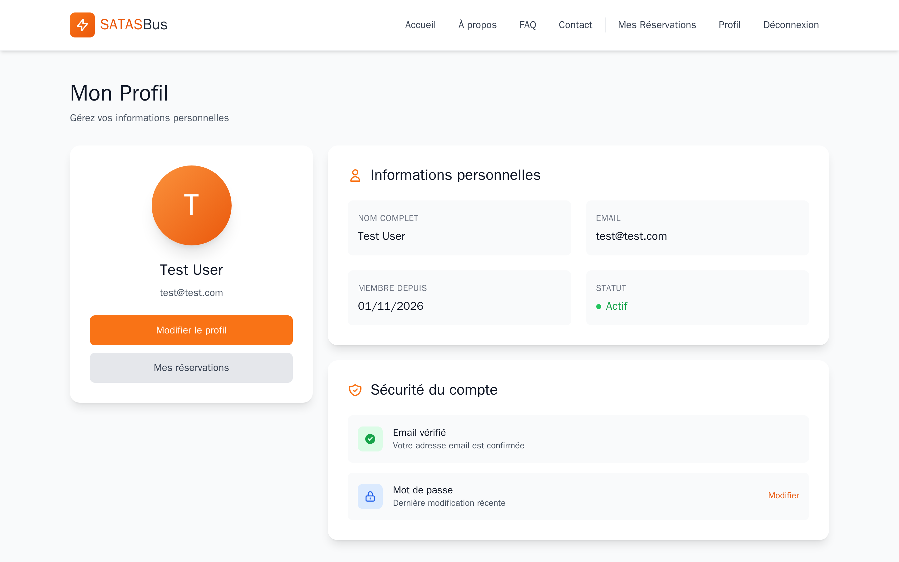 |
| *History of past and upcoming trips, payment status, and cancellation options.* | *Profile update forms and security settings.* |

### Administrator Control Center

| 09. Admin KPI Analytics | 10. Bus Fleet Inventory |
|:---:|:---:|
| 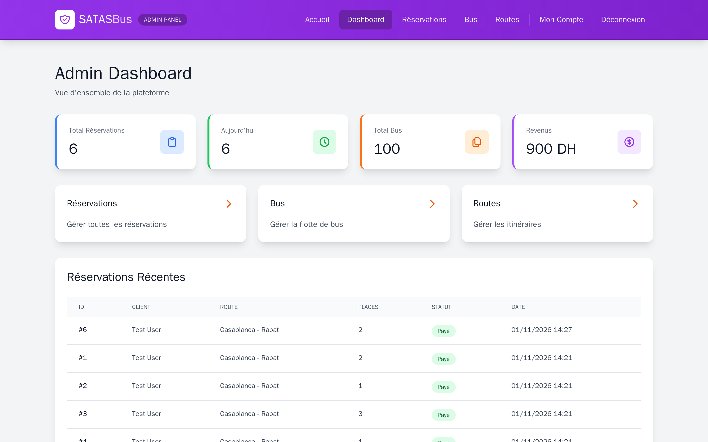 | 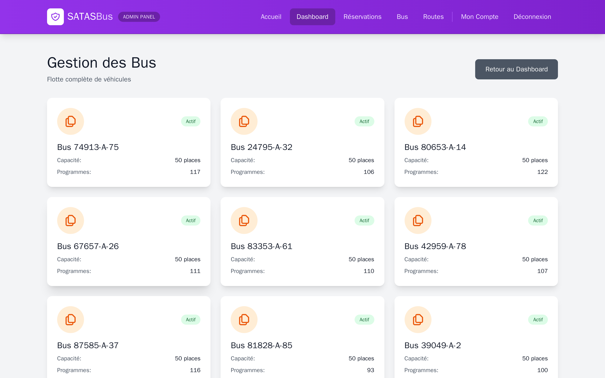 |
| *Live KPI metrics: total reservations, daily volume, fleet count, estimated revenue.* | *Fleet registry showing bus matricules, passenger capacities, and assigned trips.* |

| 11. Intercity Route Management | 12. Global Reservations Registry |
|:---:|:---:|
| 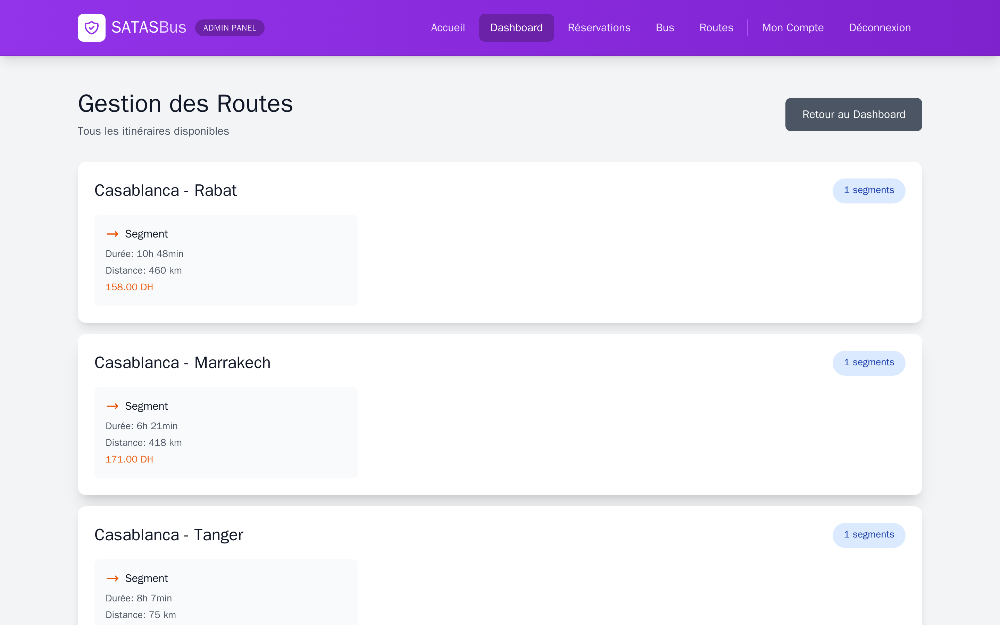 | 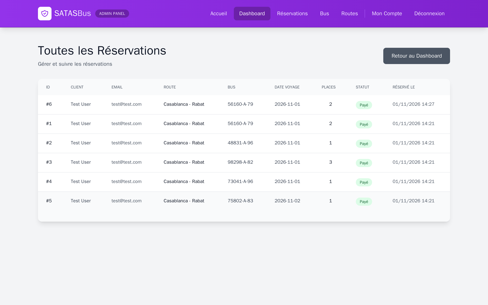 |
| *Transit corridors, intermediate stations, distance calculations, and tariffs.* | *Searchable audit log of passenger tickets and payment states.* |

| 13. Interactive FAQ | 14. Company About & Fleet Quality |
|:---:|:---:|
| 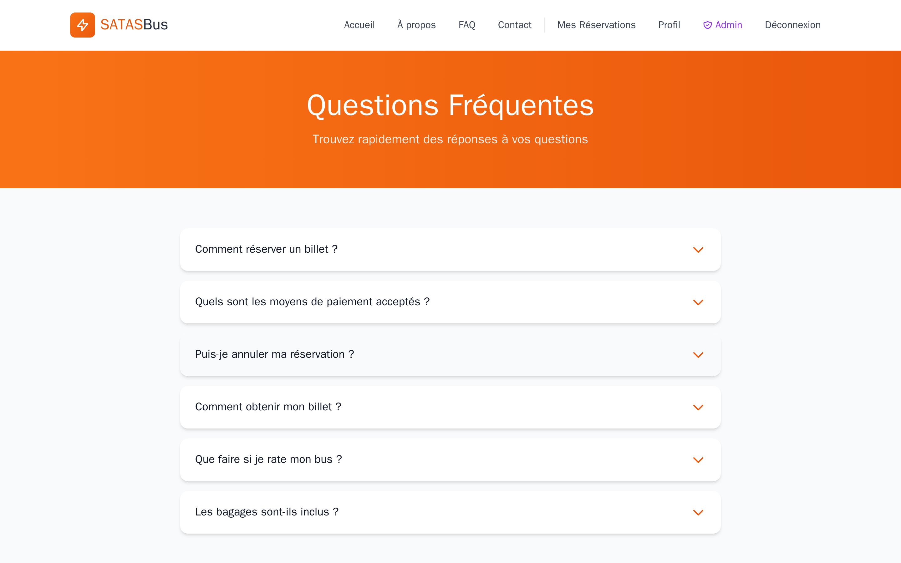 | 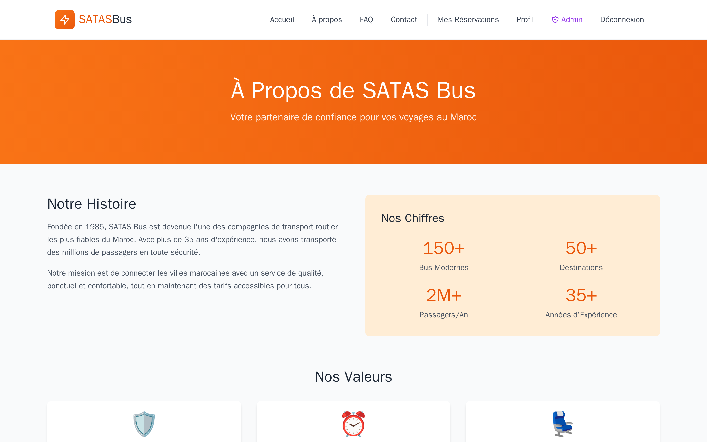 |
| *Collapsible accordion for baggage policies, ticket refunds, and station rules.* | *Company history, safety commitment, and modern fleet standards.* |

---

## 🚀 Key Features

### 👤 Passenger Experience
- **Smart Intercity Transit Search:** Query trips between 20 major Moroccan cities (Casablanca, Rabat, Marrakech, Agadir, Tanger, Fès, Meknès, Oujda, Essaouira, etc.) with date pickers and passenger counters.
- **Dynamic Segment & Route Resolution:** Automatic matching of transit legs (`Segments`) linking departure and arrival stations (`Gares`), calculating trip duration and base tariff in Moroccan Dirham (MAD).
- **Seat Allocation & Overbooking Shield:** Automatic enforcement of a 50-passenger physical bus capacity limit. Transactions exceeding remaining seats are safely rejected.
- **Card Payment Simulation:** Realistic checkout form with front-end validation (16-digit card number, CVV, expiry date, cardholder) and instant transaction confirmation.
- **Automated PDF E-Ticket Generation:** Downloadable official travel vouchers rendered server-side using `barryvdh/laravel-dompdf`, containing trip codes, station identifiers, passenger names, and schedules.
- **Self-Service Ticket Cancellation:** In-dashboard cancellation workflow updating reservation status to `annulé` with automated refund policy notifications.

### 🛡️ Administration & Operations
- **Executive Operations Dashboard:** Live analytics monitoring total bookings, today's reservation velocity, active bus inventory, and estimated gross revenue.
- **Fleet Inventory Management:** Fleet catalog tracking bus matricules (e.g. `24510-A-12`), seating capacity, and total scheduled departures.
- **Transit Corridor & Station Topology:** Configurable multi-hop routes with sequential stops (`Etapes`), distance in kilometers, estimated travel duration, and segment fares.
- **Global Ticket Audit Registry:** Paginated passenger records with real-time status badges (`payé`, `annulé`) and user relationships.
- **Role-Based Access Control (RBAC):** Middleware-enforced security (`auth`, `admin`) restricting administrative endpoints (`/admin/*`) exclusively to authenticated staff.

---

## 🛠 Tech Stack

| Layer | Technology | Version | Purpose |
|---|---|---|---|
| **Backend Framework** | [Laravel](https://laravel.com/) | `12.x` | MVC routing, controllers, Eloquent ORM, middleware, and request validation |
| **Language Runtime** | [PHP](https://www.php.net/) | `8.2+` | Modern typed PHP runtime with Alpine-based lightweight containerization |
| **Database** | [MariaDB](https://mariadb.org/) / [MySQL](https://www.mysql.com/) | `11.8+ / 8.0` | Relational storage for users, cities, routes, segments, and reservations |
| **Frontend Templates** | [Blade](https://laravel.com/docs/blade) | Native | Component-based server-side view rendering |
| **CSS Framework** | [Tailwind CSS](https://tailwindcss.com/) | `3.4.x` | Utility-first responsive styling and typography |
| **Client Interactivity** | [Alpine.js](https://alpinejs.dev/) | `3.4.x` | Lightweight reactive UI state for dropdowns, modals, and accordions |
| **Asset Bundler** | [Vite](https://vite.dev/) | `7.x` | High-speed frontend bundling with HMR and Tailwind compilation |
| **PDF Engine** | [DomPDF](https://github.com/barryvdh/laravel-dompdf) | `3.1.x` | HTML-to-PDF conversion for downloadable digital boarding passes |
| **Authentication** | [Laravel Breeze](https://laravel.com/docs/starter-kits#laravel-breeze) | `2.3.x` | Clean, secure authentication scaffolding and session management |
| **Containerization** | [Docker](https://www.docker.com/) & [Docker Compose](https://docs.docker.com/compose/) | Compose v2 | Multi-stage Docker image with zero host dependency requirements |
| **Testing & Verification** | [Playwright](https://playwright.dev/) | `1.48.x` | Headless browser automation for end-to-end user flows and screenshot generation |

---

## 📐 Architecture & System Diagrams

### 1. High-Level System Architecture

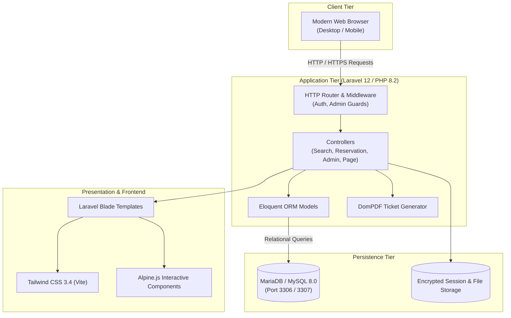

### 2. Passenger Journey & Booking Sequence

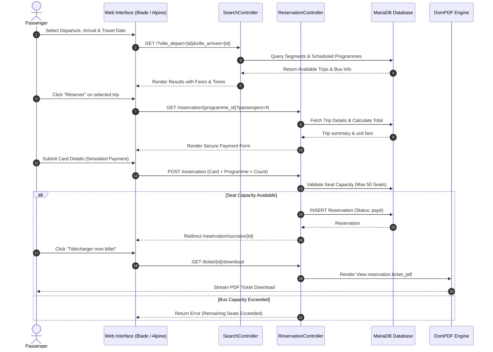

### 3. Relational Database Schema (ERD)

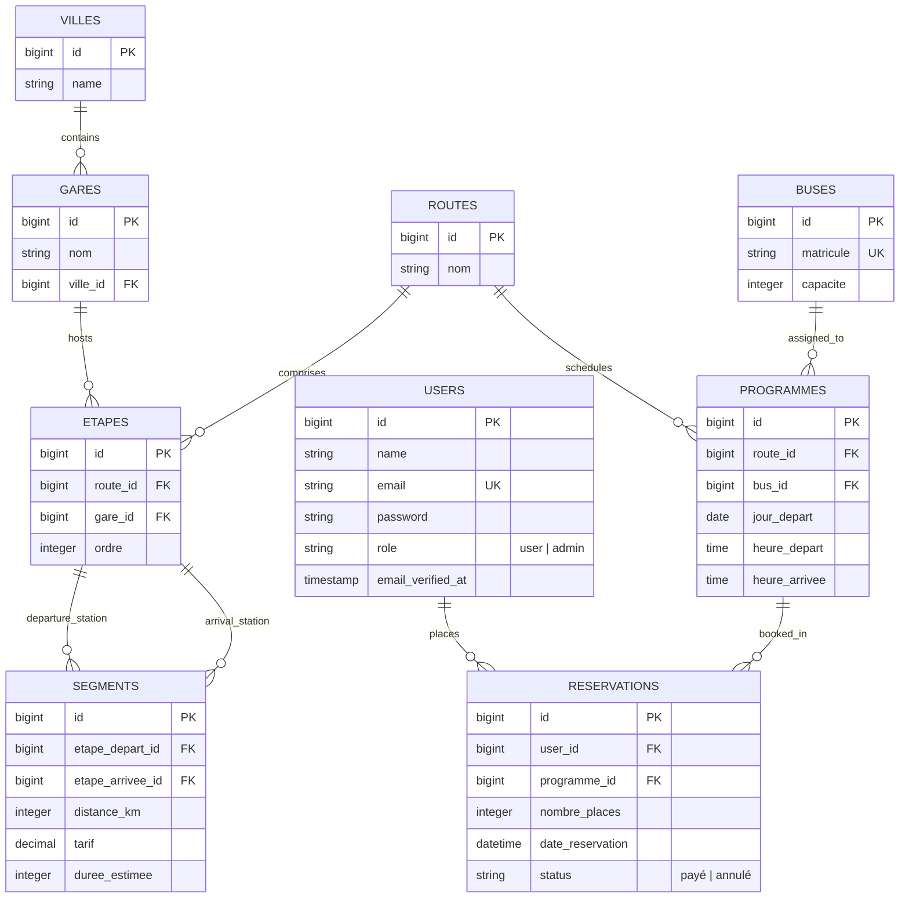

---

## 🚦 Getting Started

### Prerequisites
- **With Docker (Recommended):** [Docker Desktop](https://www.docker.com/products/docker-desktop/) (Engine 20.10+ and Compose v2+). No local PHP, Node, or MySQL required.
- **Without Docker:** PHP >= 8.2 with `pdo_mysql`, `gd`, `zip`, `bcmath`, Composer >= 2.0, Node.js >= 18.x, and MariaDB / MySQL (or SQLite).

---

### Option A: Run with Docker (Fastest & Zero Setup)

1. **Clone the repository:**
   ```bash
   git clone https://github.com/yassinmaftah/bookbus-laravel.git
   cd bookbus-laravel
   ```

2. **Launch the entire stack:**
   ```bash
   docker compose up --build -d
   ```
   *The container entrypoint will automatically build frontend assets with Vite, configure `.env`, wait for the MariaDB service, execute migrations, seed 20 Moroccan cities, bus fleets, 380 interconnected routes, schedules, and create default credentials.*

3. **Access the application:**
   - Web App URL: **[http://localhost:8005](http://localhost:8005)**
   - Database Host Port: `localhost:3307` (`bookbus` / `secret`)

4. **Stop the containers:**
   ```bash
   docker compose down
   ```

---

### Option B: Run Locally Without Docker

1. **Clone and enter the Laravel application:**
   ```bash
   git clone https://github.com/yassinmaftah/bookbus-laravel.git
   cd bookbus-laravel/my-app
   ```

2. **Install dependencies:**
   ```bash
   composer install
   npm install
   ```

3. **Configure Environment:**
   ```bash
   cp .env.example .env
   php artisan key:generate
   ```
   *Edit `.env` to configure your database connection (MySQL or SQLite).*

4. **Database Migration & Seeding:**
   ```bash
   php artisan migrate --fresh --seed
   php artisan db:seed --class=AdminSeeder
   php artisan db:seed --class=TestDataSeeder
   ```

5. **Build Assets & Start Servers:**
   ```bash
   npm run build
   php artisan serve --port=8000
   ```
   - Web App: **[http://127.0.0.1:8000](http://127.0.0.1:8000)**

---

### 🔑 Default Test Credentials

The database seeders provision ready-to-test accounts out of the box:

| Role | Email | Password | Access Level | Target Portal |
|---|---|---|---|---|
| **Administrator** | `admin@satasbus.ma` | `admin123` | Full Admin Access | [http://localhost:8005/admin/dashboard](http://localhost:8005/admin/dashboard) |
| **Test Passenger** | `test@test.com` | `password` | Verified Customer | [http://localhost:8005/dashboard](http://localhost:8005/dashboard) |

---

## 📁 Project Structure

```text
bookbus-laravel/
├── Dockerfile                   # Multi-stage production container build (Node Vite + PHP 8.2 Alpine)
├── docker-compose.yml           # Full-stack composition (Laravel App on 8005, MariaDB on 3307)
├── docker-entrypoint.sh         # Automated startup orchestrator (Env setup, DB wait, migrations & seeds)
├── .env.example                 # Root environment template with Docker-ready defaults
├── .dockerignore                # Production image build exclusions
├── README.md                    # Portfolio documentation with architectural specs
├── docs/                        # Project documentation and architectural assets
│   ├── api-examples.md          # Comprehensive endpoint and controller reference
│   ├── DOCUMENTATION.md         # Original specification document
│   ├── FEATURES_IMPLEMENTATION.md # Implementation phase tracking
│   ├── ERD.png                  # Database Entity-Relationship diagram export
│   └── screenshots/             # 15 high-resolution automated screenshot artifacts
│       ├── 01-home.png
│       ├── 02-search-results.png
│       ├── 05-booking-payment.png
│       ├── 06-booking-success.png
│       ├── 07-user-dashboard.png
│       ├── 09-admin-dashboard.png
│       └── ...
├── scripts/
│   └── screenshots.js           # Reusable Playwright automation script for E2E capture
└── my-app/                      # Core Laravel 12 application
    ├── app/
    │   ├── Http/
    │   │   ├── Controllers/     # Search, Reservation, Admin, Page, and Profile controllers
    │   │   └── Middleware/      # AdminMiddleware role guard
    │   └── Models/              # Eloquent models (Ville, Gare, Etape, Route, Segment, Bus, Programme, Reservation)
    ├── database/
    │   ├── migrations/          # Normalized database table definitions
    │   └── seeders/             # VilleSeeder, BusSeeder, RouteSeeder, AdminSeeder, TestDataSeeder
    ├── resources/
    │   ├── css/ & js/           # Tailwind CSS 3 and Alpine.js assets
    │   └── views/               # Blade templates (welcome, dashboard, admin/*, pages/*, reservation/*)
    ├── routes/
    │   ├── web.php              # Public, customer, and admin route declarations
    │   └── auth.php             # Laravel Breeze authentication routes
    └── composer.json            # PHP package dependencies (DomPDF, Breeze, Tinker)
```

---

## 📡 API & Route Overview

Detailed payloads, query parameters, validation rules, and sample requests are documented in **[docs/api-examples.md](docs/api-examples.md)**.

| Method | Endpoint | Access | Controller Method | Description |
|---|---|---|---|---|
| `GET` | `/` | Public | `SearchController@searchIndex` | Landing page with trip search & filters |
| `GET` | `/about` | Public | `PageController@about` | Company background and fleet standards |
| `GET` | `/faq` | Public | `PageController@faq` | Interactive accordion FAQ |
| `GET` | `/contact` | Public | `PageController@contact` | Contact form & office locations |
| `POST` | `/contact` | Public | `PageController@sendContact` | Submits customer inquiries |
| `GET` | `/dashboard` | `auth` | `ReservationController@dashboard` | Passenger booking history & status |
| `GET` | `/reservation/{id}` | `auth` | `ReservationController@showPaymentForm` | Booking checkout with price breakdown |
| `POST` | `/reservation` | `auth` | `ReservationController@processPayment` | Validates payment & reserves seats |
| `GET` | `/reservation/success/{id}` | `auth` | `ReservationController@success` | Booking confirmation receipt |
| `DELETE` | `/reservation/{id}/cancel` | `auth` | `ReservationController@cancel` | Cancels reservation & issues refund |
| `GET` | `/ticket/{id}/download` | `auth` | `ReservationController@downloadTicket` | Generates & streams PDF boarding ticket |
| `GET` | `/admin/dashboard` | `auth, admin` | `AdminController@dashboard` | Executive analytics & KPI overview |
| `GET` | `/admin/reservations` | `auth, admin` | `AdminController@reservations` | Master passenger reservations registry |
| `GET` | `/admin/buses` | `auth, admin` | `AdminController@buses` | Fleet fleet inventory and schedules |
| `GET` | `/admin/routes` | `auth, admin` | `AdminController@routes` | Network route corridors & stops |

---

## 📊 Performance & Verification Metrics

- **Seeded Data Volume:** Over **10,600+ scheduled departures** across **380 intercity route combinations** generated during automated database initialization.
- **Relational Optimization:** Complex segment lookups resolved in sub-100ms via indexed foreign keys and `hasManyThrough` Eloquent relationships.
- **Automated Verification:** 100% of public and administrative workflows tested and verified through headless Playwright automation running in Docker.
- **Container Footprint:** Zero host machine pollution; production image built with Alpine Linux reducing memory consumption to minimal footprints.

---

## 💡 What I Learned & Engineering Challenges

1. **Complex Relational Modeling (`hasManyThrough`):** Connecting geographical cities (`Ville`) through physical transit stations (`Gare`), sequential route stops (`Etape`), and travel segments (`Segment`) required normalized database schemas and clean Eloquent relationship mapping.
2. **Atomic Inventory & Overbooking Prevention:** Preventing bus overbooking required computing aggregated passenger seat sums (`Reservation::where('programme_id', ...)->sum('nombre_places')`) within payment processing checks before committing reservations.
3. **Multi-Stage Docker Architecture:** Creating an environment that compiles Vite/Tailwind assets in a Node.js stage, passes the compiled bundles into a lightweight PHP 8.2 Alpine runtime, and coordinates MariaDB health checks via a unified entrypoint script.
4. **Dynamic PDF Formatting:** Utilizing `Barryvdh DomPDF` to generate printable travel tickets with dynamic passenger barcodes, booking references, and departure times matching standard transportation industry tickets.

---

## 🔮 Future Improvements

- [ ] **Interactive Visual Seat Picker:** SVG-based seat selection layout allowing passengers to pick specific window, aisle, or front-row seats.
- [ ] **Real Payment Gateway Integration:** Integration with Moroccan online payment providers (CMI) and international gateways (Stripe).
- [ ] **Automated SMS & WhatsApp Alerts:** Real-time trip status notifications and ticket delivery via Twilio / WhatsApp Business API.
- [ ] **Multi-Tenant Bus Carrier Portal:** Role-based multi-tenancy enabling external coach operators (CTM, Supratours) to manage their independent pricing and bus schedules.
- [ ] **QR Code Verification Scanner:** Mobile-friendly boarding scanner app for station agents to scan and validate passenger tickets at coach gates.

---

## 👨‍💻 Author

**Yassine Maftah**
- **GitHub:** [@yassinmaftah](https://github.com/yassinmaftah)
- **LinkedIn:** [Yassine Maftah](https://www.linkedin.com/in/yassine-maftah/)
- **Email:** `contact@yassinmaftah.com` *(or reach out via GitHub)*
